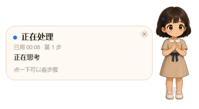
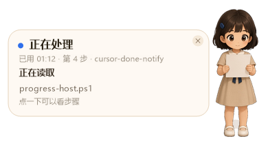
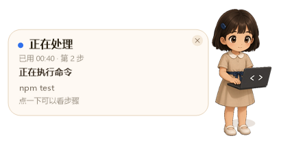
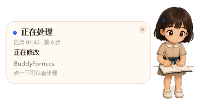
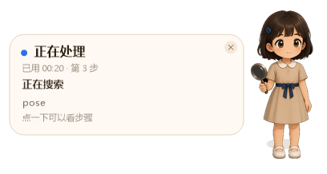
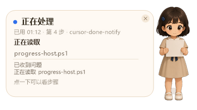
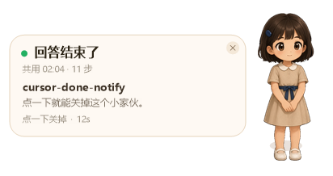
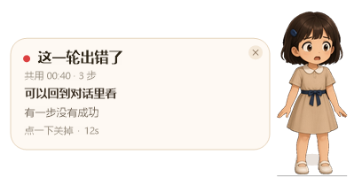
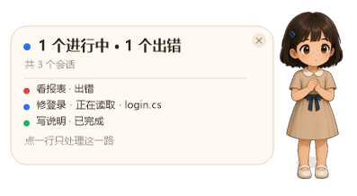

# 点点

A Windows desktop buddy for [Cursor](https://cursor.com). It follows an Agent turn through Cursor hooks and stays on screen while the agent reads, edits, and runs commands. When the turn finishes, it plays a sound and shows a short snippet of the reply.

点点是 Cursor Agent 的 Windows 桌面伙伴。Agent 开始干活后，它出现在桌面右下角，跟着读文件、改代码、跑命令换动作；这一轮结束、中断或出错时响一声，并带上回答摘要。多个对话同时进行时，它收成一张总览。

## 效果

窗口本身是透明的，贴在桌面右下角。

| 正在思考 | 正在读取 | 正在执行命令 |
| --- | --- | --- |
|  |  |  |

| 正在修改 | 正在搜索 | 点开最近步骤 |
| --- | --- | --- |
|  |  |  |

| 回答结束 | 这一轮出错 | 多个会话 |
| --- | --- | --- |
|  |  |  |

## 动作

每个状态各有一段循环动画。

| 空闲 | 思考 | 读取 | 修改 |
| --- | --- | --- | --- |
|  |  |  |  |

| 命令 | 搜索 | 完成 | 出错 |
| --- | --- | --- | --- |
|  |  |  |  |

这是一个非官方工具，和 Cursor 没有隶属关系。

## 需要什么

- Windows 10 或更新版本
- 系统自带的 Windows PowerShell 5.1 和 .NET Framework 4.x
- 桌面版 Cursor，并且能使用 Hooks

不需要单独安装 Node.js、Python 或 .NET SDK。`install.cmd` 会用 Windows 自带的 `csc.exe` 编译两个小程序。

## 安装

1. 把这个仓库克隆或下载到一个你打算一直留着的目录。Hook 会按这个路径启动点点，之后不要把文件夹挪走。
2. 双击 `install.cmd`。
3. 完全退出 Cursor，再重新打开。
4. 开始一轮 Agent 对话。点点会出现在鼠标所在屏幕的右下角。

安装程序写入的是用户级配置 `%USERPROFILE%\.cursor\hooks.json`。原来已经存在的其他 hook 会保留，只会换掉点点自己的条目。

这些 hook 只负责把状态告诉点点。`beforeSubmitPrompt` 固定回答继续，`preToolUse` 和 `subagentStart` 固定回答允许，不会替你拦截工具。

## 使用

- 拖动窗口可以搬家，松手后位置会记住。
- 点角色会戳一下。进行中点窗口其他位置，可以展开或收起最近几步。
- 这一轮结束、中断或出错后，点窗口就能关掉；也可以等它自己消失。
- 右上角的关闭同样有效。
- 好几个对话同时在跑时，窗口变成总览。点一行就盯住这一路，并尝试把对应工作区的 Cursor 窗口调到前面；再点一次回到总览。已经结束的那一行，点一下就从总览里去掉。

结束时的声音沿用 Windows 系统音：正常完成、中断、出错各一声。

默认停留 12 秒。要改的话，设置用户环境变量 `CURSOR_NOTIFY_SECONDS`（允许 3 到 60），然后完全退出 Cursor 再打开：

```powershell
[Environment]::SetEnvironmentVariable('CURSOR_NOTIFY_SECONDS', '20', 'User')
```

## 卸载

双击 `uninstall.cmd`。它会关掉点点，并只从 `hooks.json` 里删掉点点的条目。然后完全退出 Cursor 再打开。

## 它怎么工作

```text
Cursor Agent
    │  stdin 上的 hook JSON
    ▼
hook-relay.exe          立刻回复 {} / allow / continue
    │  截短后写入 %TEMP%\cursor-done-notify\inbox
    ▼
progress-host.ps1       按对话分开记状态
    │
    ▼
BuddyForm.dll           画点点
```

安装时注册的事件：`beforeSubmitPrompt`、`preToolUse`、`postToolUse`、`postToolUseFailure`、`afterAgentThought`、`afterAgentResponse`、`subagentStart`、`subagentStop`、`stop`。

事件只留在本机临时目录里。过长的提示、命令和回答会截短后再交给窗口。点点不会把这些内容发出去。

`notify-done.ps1` 是一个更早的纯文字弹窗，安装程序不会注册它。

## 开发

在仓库目录里可以跑状态机自测，不需要弹出窗口：

```powershell
$env:CURSOR_NOTIFY_SELFTEST = '1'
powershell -NoProfile -ExecutionPolicy Bypass -File .\progress-host.ps1
```

通过时输出 `SELFTEST OK`。`tests/hooks.ps1` 会先跑这段自测，再用一个临时用户目录检查安装和卸载：别人的 hook 还在，点点的条目会被去掉。它不会改你自己的 `%USERPROFILE%\.cursor\hooks.json`。

```powershell
powershell -NoProfile -ExecutionPolicy Bypass -File .\tests\hooks.ps1
```

改完 `HookRelay.cs` 或 `BuddyForm.cs` 后，再运行一次 `install.cmd`。编译产物 `hook-relay.exe` 和 `BuddyForm.dll` 不进版本库。

## 许可

[MIT](LICENSE)。角色图也随这个仓库一起提供。
