# 点点

A Windows desktop buddy for [Cursor](https://cursor.com). It follows an Agent turn through Cursor hooks and stays on screen while the agent reads, edits, and runs commands. When the turn finishes, it plays a sound and shows a short snippet of the reply. A bar at the bottom shows your Cursor usage for the billing cycle. The UI follows the Windows display language (Chinese or English) and can be switched from the right-click menu.

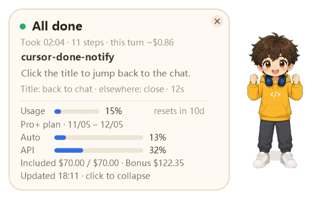

点点是 Cursor Agent 的 Windows 桌面伙伴：一个戴耳机、穿卫衣的 Q 版程序员。Agent 开始干活后，它出现在桌面右下角，跟着读文件、改代码、跑命令换动作；这一轮结束、中断或出错时响一声，并带上回答摘要。多个对话同时进行时，它收成一张总览。气泡底部常驻一条 Cursor 额度栏，点开能看本期用量详情。

## 效果

窗口本身是透明的，贴在桌面右下角。

| 正在思考 | 正在读取 | 正在执行命令 |
| --- | --- | --- |
| 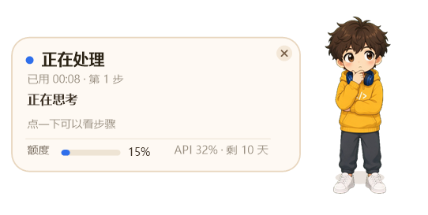 | 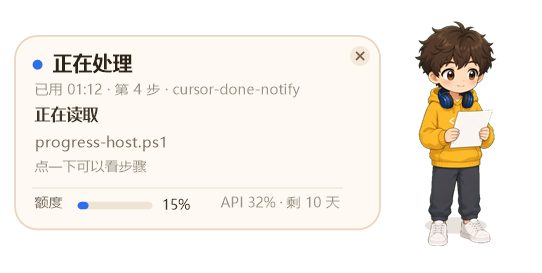 | 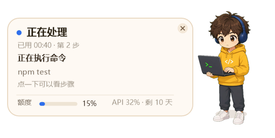 |

| 正在修改 | 正在搜索 | 点开最近步骤 |
| --- | --- | --- |
| 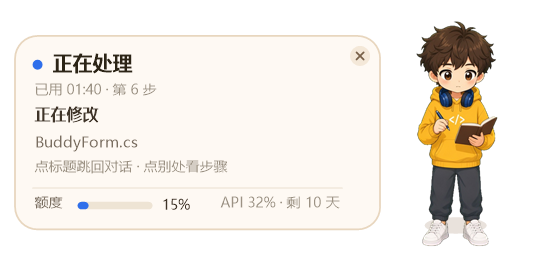 | 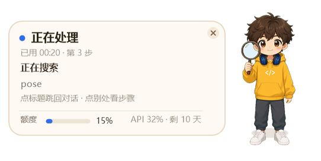 | 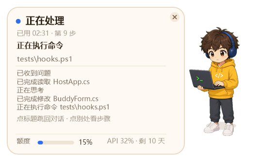 |

| 回答结束 | 这一轮出错 | 多个会话 |
| --- | --- | --- |
| 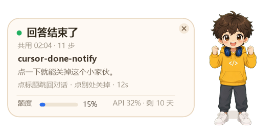 | 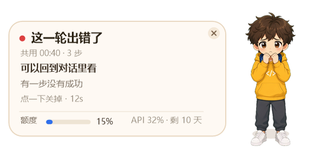 | 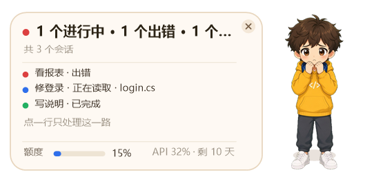 |

| 额度详情 | 额度提醒 | 深色主题 |
| --- | --- | --- |
| 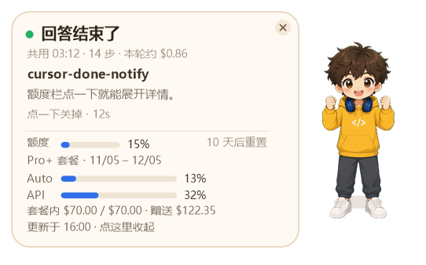 | 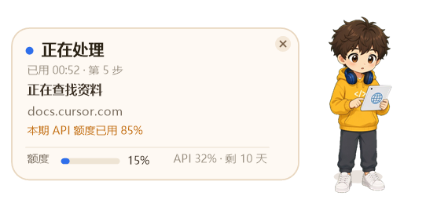 | 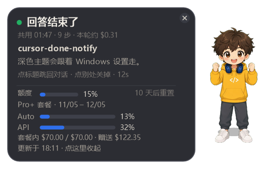 |

## 动作

每个状态各有一段循环动画。

| 空闲 | 思考 | 读取 | 修改 |
| --- | --- | --- | --- |
|  |  |  |  |

| 命令 | 搜索 | 完成 | 出错 |
| --- | --- | --- | --- |
|  |  |  |  |

| 派子任务 | 查资料 | 已中断 | 打瞌睡 |
| --- | --- | --- | --- |
|  |  |  | 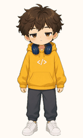 |

查资料也用于网页搜索和外部（MCP）工具。一轮进行中超过 90 秒没有新事件、也没有工具在跑时，点点会打瞌睡；会话失去连接时也是这个动作。

这是一个非官方工具，和 Cursor 没有隶属关系。

## 需要什么

- Windows 10 或更新版本
- 系统自带的 .NET Framework 4.x（安装脚本用到系统自带的 Windows PowerShell 5.1）
- 桌面版 Cursor，并且能使用 Hooks

不需要单独安装 Node.js、Python 或 .NET SDK。`install.cmd` 会用 Windows 自带的 `csc.exe` 编译两个小程序；读取额度用的是 Windows 自带的 `winsqlite3.dll`。

## 安装

1. 把这个仓库克隆或下载到一个你打算一直留着的目录。Hook 会按这个路径启动点点，之后不要把文件夹挪走。
2. 双击 `install.cmd`。
3. 完全退出 Cursor，再重新打开。
4. 开始一轮 Agent 对话。点点会出现在鼠标所在屏幕的右下角。

安装程序写入的是用户级配置 `%USERPROFILE%\.cursor\hooks.json`。原来已经存在的其他 hook 会保留，只会换掉点点自己的条目。

双击安装默认使用**安全模式**：不注册需要返回权限决定的 Hook，因此不会替 Cursor 允许工具执行；读、写、搜索和命令动作会在相应工具完成后显示。

如果希望动作从工具开始时就实时变化，可以显式启用实时模式：

```powershell
powershell -NoProfile -ExecutionPolicy Bypass -File .\install.ps1 -EnableRealtime
```

实时模式会注册 `preToolUse` 和 `subagentStart`，并按照 Cursor Hook 协议返回 `permission: "allow"`。这会参与 Cursor 的工具权限决策，只应在你理解并接受这一行为时启用。重新运行普通的 `install.cmd` 会切回安全模式。

更新配置前会在同目录保留一份 `hooks.json.bak`；写入使用临时文件替换，避免中途退出损坏配置。

## 使用

- 拖动窗口可以搬家，松手后位置会记住。
- 点角色会戳一下。进行中点窗口其他位置，可以展开或收起最近几步。
- 点标题跳回这个对话：在终端里用 Cursor CLI 时切到那个终端窗口，在 Cursor 里时切到对应项目的窗口。
- 这一轮结束、中断或出错后，点窗口就能关掉；也可以等它自己消失。
- 右上角的关闭同样有效。
- 好几个对话同时在跑时，窗口变成总览。点一行就盯住这一路，并尝试把对应工作区的 Cursor 窗口调到前面；再点一次回到总览。已经结束的那一行，点一下就从总览里去掉。
- 右键点窗口，或者点任务栏托盘里的点点图标，会弹出菜单：静音、正看着对话时不打扰、显示额度栏、主题（跟随系统、浅色、深色）、结束后停留多久、多久没动静算失联、语言（跟随系统、中文、English）、打开 Cursor 用量页、先关掉点点。这些选择保存在 `%APPDATA%\cursor-done-notify\settings.txt`，立即生效，不用重启 Cursor。

结束时的声音沿用 Windows 系统音：正常完成、中断、出错各一声。静音后不再响。如果一轮结束时你正看着这个对话（前台就是跑它的终端或 Cursor 窗口），默认不响，气泡 4 秒后就收起。

主题默认跟随 Windows 的“应用模式”，深色模式下气泡变深。

默认停留 12 秒，可以在右键菜单的“结束后停留”里改。也可以设置用户环境变量 `CURSOR_NOTIFY_SECONDS`（允许 3 到 60），菜单里选过的值优先：

```powershell
[Environment]::SetEnvironmentVariable('CURSOR_NOTIFY_SECONDS', '20', 'User')
```

如果 Cursor 意外退出，长时间收不到事件的会话默认会在 180 分钟后标成“会话失去连接”。可以在右键菜单的“多久没动静算失联”里改，或者用 `CURSOR_NOTIFY_STALE_MINUTES` 调整为 10 到 1440 分钟：

```powershell
[Environment]::SetEnvironmentVariable('CURSOR_NOTIFY_STALE_MINUTES', '60', 'User')
```

## 额度

气泡底部的额度栏显示本期综合用量、指定模型（API）用量和离重置还有几天；进度条超过 70% 变橙，超过 90% 变红。点一下额度栏展开详情：套餐名、账单周期、Auto 与 API 两条用量、套餐内金额和赠送金额、更新时间，再点一下收起。

数据来自 Cursor 自己的用量接口（`api2.cursor.sh` 上的 `DashboardService`），和 Cursor 设置页看到的是同一份。点点从本机 `%APPDATA%\Cursor\User\globalStorage\state.vscdb` 读取 Cursor 已保存的登录令牌，只发给 Cursor 的服务器，不保存也不发给别处。窗口出现时拉一次，之后每 5 分钟、每轮结束时、以及展开详情时刷新（两次之间至少隔 20 秒）。结果缓存在 `%TEMP%\cursor-done-notify\quota-cache.txt`，只有数字，没有令牌；下次出现时先显示缓存。

一轮结束时，元信息行会多一段“本轮约 $0.42”：这一轮开始后第一次拉到的已用金额，和结束后最新一次的差。Cursor 记账有延迟，最后几次请求可能还没算进去，所以只是估算；如果同时还有别的对话在跑，会写成“期间约”，因为额度是整个账号共用的。

综合用量或 API 用量第一次超过 80%、第一次用完时，提示行会变成橙色提醒并响一声，每个账单周期每档只提醒一次。

不想看额度栏，在右键菜单里取消“显示额度栏”即可。想彻底不查询额度（也就不会有每轮花费和提醒），设置：

```powershell
[Environment]::SetEnvironmentVariable('CURSOR_NOTIFY_QUOTA', '0', 'User')
```

## 卸载

双击 `uninstall.cmd`。它会关掉点点，只从 `hooks.json` 里删掉当前安装目录对应的条目，并清理临时事件、摘要和错误日志；窗口位置和右键菜单里的设置会保留。然后完全退出 Cursor 再打开。

## 它怎么工作

```text
Cursor Agent
    │  stdin 上的 hook JSON
    ▼
hook-relay.exe          立刻回复 {} / allow / continue
    │  截短后写入 %TEMP%\cursor-done-notify\inbox
    │  每轮第一个事件顺带记下跑这个对话的窗口（终端或 Cursor）
    ▼
buddy-host.exe          监听收件箱，按对话分开记状态，画点点，查额度
```

`buddy-host.exe` 由 `Host.cs`（状态机）、`HostApp.cs`（窗口、托盘、自测、预览）、`BuddyForm.cs`（绘制）和 `Quota.cs`（额度）编译而成。它只在有对话时运行，所有对话都结束、窗口消失后就退出。

安全模式注册：`beforeSubmitPrompt`、`postToolUse`、`postToolUseFailure`、`afterAgentThought`、`afterAgentResponse`、`subagentStop`、`stop`。实时模式另外注册 `preToolUse` 和 `subagentStart`。

事件只留在本机临时目录里。过长的提示、命令和回答会截短后再交给窗口，超过一天的残留事件会在下次启动时清理。点点不会把这些内容发出去；唯一的网络请求是上面说的额度查询。

## 开发

`tests/hooks.ps1` 会先通过 `tests/host.ps1` 把宿主编译到临时目录，跑状态机自测（`buddy-host.exe --selftest`）和额度解析检查（不联网），再检查中继写出的事件，最后用一个临时用户目录检查安装和卸载：别人的 hook 还在，点点的条目会被去掉。它不会改你自己的 `%USERPROFILE%\.cursor\hooks.json`。

```powershell
powershell -NoProfile -ExecutionPolicy Bypass -File .\tests\hooks.ps1
```

改完任何 `.cs` 文件后，再运行一次 `install.cmd`。编译产物 `hook-relay.exe` 和 `buddy-host.exe` 不进版本库。

要重新生成 README 里的截图，运行 `buddy-host.exe --preview <目录>`，不给目录时写到 `%TEMP%\cursor-done-notify\preview`。

角色的原始图在 `docs/art`：`character.jpg` 是定稿，`pose-<动作>.jpg` 是每个动作并排的 4 帧，背景是纯绿 `#00FF00`。换了其中某张以后，运行下面的命令重新抠图、切帧、按鞋底对齐，并重新生成 `sprites/poses` 里的 PNG 和 GIF。这一步只有开发时需要，要装 Python 3、Pillow 和 numpy：

```powershell
python tools\build-sprites.py --contact
```

加上 `--contact` 会多写一张 `sprites-contact.png`，方便检查抠图边缘和帧间抖动。

## 许可

[MIT](LICENSE)。角色图也随这个仓库一起提供。
